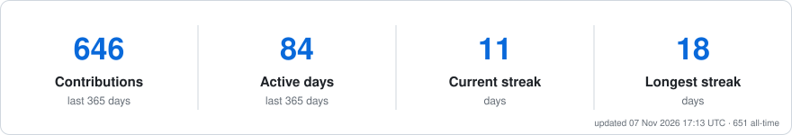

  

 

### 🧭 About Me

- 🎓 Computer Science undergraduate @ **UPES, Dehradun**
- 📊 **Data scientist** at heart: forecasting, A/B testing & causal uplift, customer analytics — from raw data and SQL to models and dashboards
- 🧠 Building end-to-end AI systems across **Generative AI** (LLMs, RAG, agents) and **Computer Vision / Deep Learning**
- 🔭 Currently deep in **time-series forecasting, experimentation** and **agentic RAG** with LLM evaluation
- 🌱 Solving **DSA** problems daily — solutions auto-synced to [DSA](https://github.com/mehtaaarush/DSA) and [codingByAarush](https://github.com/mehtaaarush/codingByAarush)
- 📫 Reach me at **aarushmehta902@gmail.com**

 

### 🛠️ Tech Stack

  

**Data Science & Analytics**
 

**AI / ML**
 

 

### 📊 Data Science Projects

<table align="center" width="100%">
<tr>
<td width="33%" valign="top">

**[🚇 Transit Ridership Forecasting](https://github.com/mehtaaarush/transit-ridership-forecasting)**
Two-week daily ridership forecasts for the Chicago Transit Authority from 25 years of boardings, weather and holidays — **4.3% WAPE**, 56% below seasonal-naive, with an interactive dashboard.
`Python` `Gradient Boosting` `Time Series`

</td>
<td width="33%" valign="top">

**[🧪 A/B Testing & Uplift Modelling](https://github.com/mehtaaarush/ab-testing-uplift-modeling)**
64,000-customer e-mail experiment: CIs with Holm correction, bootstrap & Lin adjustment, T/S-learner uplift models (AUUC) and off-policy evaluation of targeting rules.
`Python` `Statistics` `Causal ML`

</td>
<td width="33%" valign="top">

**[🛒 E-commerce Customer Analytics](https://github.com/mehtaaarush/ecommerce-customer-analytics)**
Data cleaning, trading KPIs, cohort retention, RFM segmentation, an out-of-time repurchase model and market-basket rules, with a live dashboard.
`SQL` `DuckDB` `Python`

</td>
</tr>
</table>

### 🚀 AI / ML Projects

<table align="center" width="100%">
<tr>
<td width="33%" valign="top">

**[🤖 Agentic RAG Research Assistant](https://github.com/mehtaaarush/agentic-rag-assistant)**
Agent that routes between FAISS retrieval and live web search, with a custom LLM-as-judge evaluation harness.
`Python` `LangChain` `LangGraph` `FAISS` `Gemini`

</td>
<td width="33%" valign="top">

**[📄 DocIntel](https://github.com/mehtaaarush/docintel)**
Full-stack AI document intelligence app — upload docs, chat with them, get cited answers.
`Next.js` `FastAPI` `PostgreSQL` `FAISS` `Gemini`

</td>
<td width="33%" valign="top">

**[🛰️ GPS-Free UAV Localization](https://github.com/mehtaaarush/uav-gps-free-localization)**
Camera-only drone navigation matching aerial frames to a satellite map — no GPS.
`Python` `PyTorch` `DINOv2` `FAISS`

</td>
</tr>
</table>

 

### 📈 GitHub Activity

<picture>
  <source media="(prefers-color-scheme: dark)" srcset="https://raw.githubusercontent.com/mehtaaarush/mehtaaarush/output/stats-dark.svg" />
  <source media="(prefers-color-scheme: light)" srcset="https://raw.githubusercontent.com/mehtaaarush/mehtaaarush/output/stats.svg" />
  
</picture>

  

Stats regenerate from live GitHub data every 4 hours.

 

